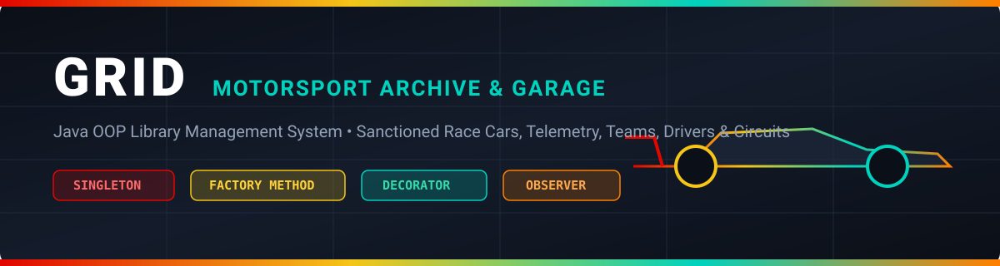
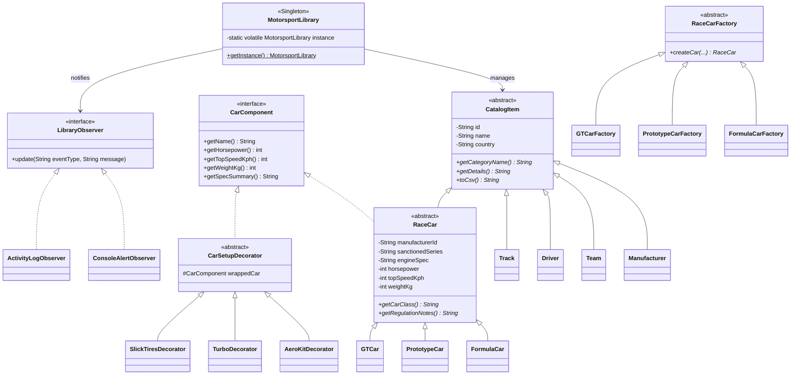

# Grid – Motorsport Library & Garage Management System



**Grid** is a Java Object-Oriented Programming (OOP) console application designed as a **Motorsport Archive & Library Management System**. Users can select world-renowned racing **Manufacturers** (Ferrari, Porsche, Mercedes-AMG, McLaren) and explore all of their **officially sanctioned racing cars**, including technical specifications, major race accolades, operating teams, drivers, and the circuits they have competed on.

This project also integrates all four **Gang of Four (GoF) Design Patterns** covered in [`Guide/tasks.pdf`](Guide/tasks.pdf): **Singleton**, **Observer**, **Decorator**, and **Factory Method**.

---

## Key Features & User Flow

1. **Manufacturer-First Drill-Down**
   - Pick a **Manufacturer** (e.g., *Ferrari*, *Porsche*, *Mercedes-AMG*, *McLaren*).
   - View all of that manufacturer's **Sanctioned Race Cars** across *FIA Formula 1*, *FIA World Endurance Championship (Hypercar / LMGT3)*, *IMSA*, and *FIA GT World Challenge*.
   - Select any **Race Car** (e.g., *Ferrari 499P*, *Ferrari SF-24*, *Porsche 963*) to inspect its **Official Dossier**:
     - **Sanctioned Series & Class Regulations** (`FORMULA`, `PROTOTYPE`, `GT`)
     - **Technical Specifications** (Engine, Horsepower, Top Speed, Minimum Weight)
     - **Major Accolades & Victories** (e.g., *24 Hours of Le Mans Winner*, *Monaco GP Winner*)
     - **Operating Teams** (Team Principal, Country, Primary Series)
     - **Notable Drivers** (Car Number, Nationality, Team, World/Major Titles)
     - **Sanctioned Tracks Run On** (Track Length, Turns, Lap Record)
2. **Polymorphic Catalog Search**
   - Search across all 5 entity types (`Manufacturer`, `RaceCar`, `Team`, `Driver`, `Track`) by name, country, series, or specification.
3. **Register New Sanctioned Cars & Accolades**
   - Dynamically create new `FormulaCar`, `PrototypeCar`, or `GTCar` entries via the **Factory Method** pattern and persist them to CSV files.
4. **Personal Garage & Race Setup Tuner**
   - Bookmark any car to your Personal Garage, dynamically wrap it in stackable **Decorator** setup packages (*Low-Drag Aero*, *Qualifying Engine Boost*, *Soft-Compound Racing Slicks*), and compare the **Tuned Garage Car vs. Stock Homologation** side by side.
5. **Interactive Circuit & Team Cross-Drill-Down + Head-to-Head Comparison**
   - Drill directly from any car's dossier into a **Track Profile** or **Operating Team Profile** to see all other sanctioned cars that have competed there, or run a **Head-to-Head Telemetry Comparison** between any two cars with visual stat bars and delta calculations.
6. **Live Notification Center**
   - Receive real-time console alerts and browse a timestamped session activity log powered by the **Observer** pattern, with the ability to subscribe/unsubscribe at runtime.

---

## Core OOP Principles

| OOP Pillar | Implementation in Grid |
| :--- | :--- |
| **Abstraction** | [`CatalogItem`](src/grid/model/CatalogItem.java) is an `abstract` base class defining the contract (`getCategoryName()`, `getDetails()`, `toCsv()`) for all catalog entities. [`RaceCar`](src/grid/model/RaceCar.java) is an `abstract` class defining shared car attributes and abstract `getCarClass()` / `getRegulationNotes()` methods. |
| **Encapsulation** | All model fields are `private` with validation inside setter methods (preventing blank names, negative horsepower, or invalid track lengths). Collection getters (`getAccolades()`, `getTeamIds()`, etc.) return `Collections.unmodifiableList(...)` to protect internal state. |
| **Inheritance** | `Manufacturer`, `Team`, `Driver`, `Track`, and `RaceCar` all extend `CatalogItem` (`super(id, name, country)`). `FormulaCar`, `PrototypeCar`, and `GTCar` extend `RaceCar`. |
| **Polymorphism** | `MotorsportLibrary.searchCatalog(...)` treats all entities uniformly as `CatalogItem` references, invoking overridden `getDetails()` and `getCategoryName()` methods dynamically at runtime. |

---

## Design Patterns Implemented (Per `Guide/tasks.pdf`)

### 1. Singleton Pattern (*Exercise 1 – Settings / Central Manager*)
- **Class:** [`MotorsportLibrary`](src/grid/service/MotorsportLibrary.java)
- **Purpose:** Ensures that only **one** shared instance of the motorsport catalog and user garage exists across the entire application (`Main` CLI, `CsvStorageService`, and `LibraryObserver`s).
- **Requirements Met:**
  - `private` constructor prevents direct instantiation (`new MotorsportLibrary()` is disallowed).
  - `private static volatile MotorsportLibrary instance` with double-checked `synchronized` locking inside `public static MotorsportLibrary getInstance()` satisfies the **thread-safe Singleton additional challenge**.

### 2. Observer Pattern (*Exercise 2 – Event Notification System*)
- **Interfaces & Classes:**
  - **Observer Interface:** [`LibraryObserver`](src/grid/observer/LibraryObserver.java) (`void update(String eventType, String message)`)
  - **Concrete Observer 1:** [`ConsoleAlertObserver`](src/grid/observer/ConsoleAlertObserver.java) (prints live `[LIVE ALERT]` notifications in the terminal)
  - **Concrete Observer 2:** [`ActivityLogObserver`](src/grid/observer/ActivityLogObserver.java) (records timestamped event history for the Notification Center)
  - **Subject:** [`MotorsportLibrary`](src/grid/service/MotorsportLibrary.java) (`subscribe(...)`, `unsubscribe(...)`, `notifyObservers(...)`)
- **Requirements Met:**
  - Automatically notifies all subscribed observers when a car is registered, an accolade is added, or a garage car is bookmarked/tuned.
  - Menu Option `5` allows toggling `ConsoleAlertObserver` subscription on/off to demonstrate that an unsubscribed observer no longer receives notifications.

### 3. Decorator Pattern (*Exercise 3 – Dynamic Feature Wrapping*)
- **Interfaces & Classes:**
  - **Component Interface:** [`CarComponent`](src/grid/model/CarComponent.java)
  - **Concrete Components:** [`FormulaCar`](src/grid/model/FormulaCar.java), [`PrototypeCar`](src/grid/model/PrototypeCar.java), [`GTCar`](src/grid/model/GTCar.java) (via [`RaceCar`](src/grid/model/RaceCar.java))
  - **Abstract Decorator:** [`CarSetupDecorator`](src/grid/decorator/CarSetupDecorator.java) (implements `CarComponent` and wraps a `CarComponent`)
  - **Concrete Decorators:**
    - [`AeroKitDecorator`](src/grid/decorator/AeroKitDecorator.java) (`+15 km/h` top speed, `-5 kg` weight, appends `[+Low-Drag Aero]`)
    - [`TurboDecorator`](src/grid/decorator/TurboDecorator.java) (`+65 HP`, `+8 km/h` top speed, appends `[+Qualifying Boost]`)
    - [`SlickTiresDecorator`](src/grid/decorator/SlickTiresDecorator.java) (`+10 km/h` speed, `-8 kg` weight, appends `[+Soft Slicks]`)
- **Requirements Met:**
  - Tuning packages can be combined in **any order** and even stacked multiple times without altering the underlying `RaceCar` class in the library.

### 4. Factory Method Pattern (*Exercise 4 – Object Creation Hierarchy*)
- **Classes:**
  - **Product Hierarchy:** [`RaceCar`](src/grid/model/RaceCar.java) $\rightarrow$ [`FormulaCar`](src/grid/model/FormulaCar.java), [`PrototypeCar`](src/grid/model/PrototypeCar.java), [`GTCar`](src/grid/model/GTCar.java)
  - **Abstract Creator:** [`RaceCarFactory`](src/grid/factory/RaceCarFactory.java) (`public abstract RaceCar createCar(...)`)
  - **Concrete Creators:** [`FormulaCarFactory`](src/grid/factory/FormulaCarFactory.java), [`PrototypeCarFactory`](src/grid/factory/PrototypeCarFactory.java), [`GTCarFactory`](src/grid/factory/GTCarFactory.java)
- **Requirements Met:**
  - Both `CsvStorageService` and `Main` instantiate cars exclusively through `RaceCarFactory` without coupling to concrete car classes.

---

## Class Diagram



---

## Project Structure

```text
Grid/
├── Guide/
│   └── tasks.pdf                        # Course assignment specification (Design Patterns)
├── data/
│   ├── manufacturers.csv                # Pre-loaded Manufacturers (Ferrari, Porsche, Mercedes-AMG, McLaren)
│   ├── cars.csv                         # Sanctioned Race Cars (F1, WEC Hypercar, GT3)
│   ├── teams.csv                        # Factory & customer operating teams
│   ├── drivers.csv                      # Sanctioned series drivers
│   └── tracks.csv                       # Iconic FIA Grade 1 / endurance circuits
├── src/
│   └── grid/
│       ├── Main.java                    # Interactive Console UI entry point
│       ├── model/                       # Block 1 & 2: CatalogItem, Manufacturer, Team, Driver, Track, RaceCar
│       ├── factory/                     # Block 2: Factory Method Pattern classes
│       ├── decorator/                   # Block 3: Decorator Pattern tuning classes
│       ├── observer/                    # Block 4: Observer Pattern notification classes
│       ├── service/                     # Block 5: Thread-safe Singleton MotorsportLibrary
│       ├── storage/                     # Block 5: Plain-Java CSV persistence service
│       └── ui/                          # Block 7: ConsoleTheme (ANSI brand colors, gauges & comparison table)
└── run.bat                              # One-click Windows compile & run script
```

---

## How to Run

### Option 1: Using `run.bat` (Windows)
```powershell
.\run.bat
```

### Option 2: Standard `javac` / `java` Commands
```bash
mkdir out
javac -d out src/grid/model/*.java src/grid/factory/*.java src/grid/decorator/*.java src/grid/observer/*.java src/grid/service/*.java src/grid/storage/*.java src/grid/ui/*.java src/grid/Main.java
java -cp out grid.Main
```

---

## License & Intellectual Property Disclaimer

- **Source Code License:** The Java source code in this repository is licensed under the [MIT License](LICENSE).
- **Manufacturer & Motorsport Intellectual Property Notice:**
  This project is an **academic, non-commercial class assignment** created strictly for educational purposes to demonstrate Object-Oriented Programming (OOP) and software design patterns.
  All manufacturer names, car model designations, racing team names, driver names, circuit names, and championship titles referenced in the dataset—including **Ferrari** (*Ferrari S.p.A.*), **Porsche** (*Dr. Ing. h.c. F. Porsche AG*), **Mercedes-AMG** (*Mercedes-Benz Group AG*), **McLaren** (*McLaren Racing Limited / McLaren Automotive Limited*), **FIA Formula 1**, **FIA World Endurance Championship (WEC)**, **24 Hours of Le Mans (ACO)**, and **IMSA**—are the trademarks and intellectual property of their respective owners.
  This project is **not** affiliated with, sponsored by, or endorsed by any of the aforementioned manufacturers, teams, or motorsport sanctioning bodies.

